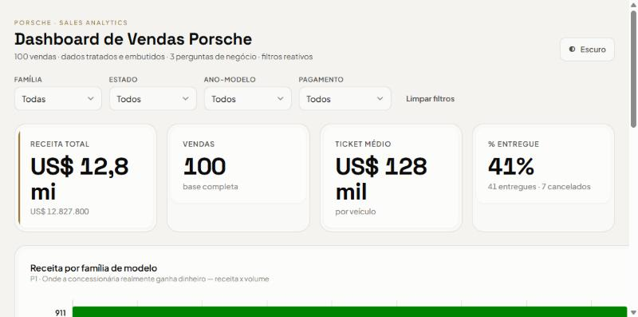

# Dashboard de Vendas Porsche

Dashboard interativa em **HTML de arquivo único**, construída a partir de uma planilha de 100 vendas da Porsche (base sanitizada do desafio DIO *Criando Agentes de Tratamento de Dados*). Responde a três perguntas de negócio com gráficos e indicadores, tem filtros reativos, tema claro/escuro e os dados embutidos no próprio HTML.

🔗 **Dashboard publicada:** https://attano2242.github.io/porsche-sales-dashboard/

> Fica no ar assim que o GitHub Pages for ligado (Settings → Pages → Deploy from a branch → `main` / root).



---

## 1. As três perguntas de negócio (e por quê)

A escolha não foi aleatória: as três perguntas contam **uma narrativa comercial completa** — *o que vende → como o dinheiro entra → o que trava* — e, de propósito, **agregam em poucas categorias com volume**, em vez de pulverizar uma base pequena (n=100).

| # | Pergunta | Por que vale uma dashboard | Como respondo |
|---|----------|----------------------------|---------------|
| **P1** | Quais **famílias de modelo** puxam a **receita** (e não só o volume)? | Volume engana. Um 911 ou Taycan de ticket alto rende mais que vários Macan. Isso decide foco de estoque e de venda. | Barras horizontais de **receita por família**, com o nº de vendas no tooltip. |
| **P2** | Como os clientes **pagam**, e quanto de receita vem de cada forma? | É fluxo de caixa e risco: à vista / wire / cripto entram rápido; financiamento e lease dependem de terceiros. Também revela o perfil do comprador de luxo. | Barras horizontais de **receita por método de pagamento**. |
| **P3** | Qual a **saúde do pipeline de entrega**? | É o gargalo operacional. Cancelamento é receita que escorre, e o que está "em andamento" é risco em aberto. | Rosca (donut) de **Entregue / Em andamento / Cancelado**, com a % entregue no centro. |

Descartei de propósito recortes que **pareciam** interessantes mas que a base não sustenta:

- **Vendas por mês / série temporal** → 24 das 100 datas vieram `INVALID` e as válidas iam até 2027. Qualquer gráfico de tempo seria enganoso.
- **Melhor vendedor** → 72 vendedores distintos em 100 vendas. É ruído, não sinal.
- **Vendas por cidade** → 79 cidades distintas. Virou filtro inútil; usei **estado** no lugar.

> Essa disciplina veio de uma análise com três lentes conflitantes (posicionamento/mix, throughput/dinheiro e anti-vaidade). A regra que sobrou: *com 100 linhas, pergunta boa agrega; pergunta ruim fatia.*

### Indicadores de topo (KPIs)
**Receita total** · **Vendas (nº)** · **Ticket médio** · **% Entregue** — todos **recalculam com os filtros aplicados**.

### Filtros
**Família · Estado · Ano-modelo · Método de pagamento** — os quatro com cardinalidade baixa o suficiente para virarem dropdown sem poluir.

---

## 2. O tratamento que a base precisou

A planilha original trazia cada campo em **duas versões**: o dado cru e o `...Sanitized`. O trabalho pesado de limpeza (ex.: `"twenty twenty four"` → `2024`, `"$121k"` → `121000`, `"1.200 mi"` → `1200`) **já estava feito na coluna sanitizada**. Mesmo assim, antes de a base ir para a dashboard, apliquei:

1. **Fiquei só com as colunas `...Sanitized`** e converti preço, ano e milhagem em número.
2. **Removi dados pessoais** — nome do cliente e vendedor **não** entram no HTML (a base vai embutida e seria exposta).
3. **Agrupei 40 modelos em 6 famílias** (`911 Turbo S`, `911 GT3`… → **911**; `Cayenne Coupe`, `Cayenne S`… → **Cayenne**; e assim por diante). Sem isso, o gráfico viraria 40 barrinhas ilegíveis.
4. **Agrupei 10 status de entrega em 3**: `Delivered` → **Entregue**; `Cancelled` → **Cancelado**; todo o resto (`Pending`, `In Transit`, `Awaiting…`, `Shipped`, `Pending Review`…) → **Em andamento**.
5. Mantive 100 linhas → exportei como um array JavaScript (~20 KB) **embutido direto no `index.html`**.

> O script de leitura/tratamento (Python puro, sem dependências) está em [`tools/`](tools/) para quem quiser auditar.

**Números que a base entrega (sem filtro):** receita **US$ 12,83 mi** · ticket médio **US$ 128,3 mil** · 41 entregues · 7 cancelados · 911 lidera a receita com **US$ 4,27 mi** em 23 vendas.

---

## 3. Como foi construída (ChatGPT Canvas, agente com skill, ou os dois?)

Segui o **caminho do agente com skills** — e levei a ideia um passo adiante: usei **dois agentes especialistas colaborando em paralelo**, cada um com a sua skill, em cima da mesma base já perfilada:

- 🎨 **Agente de design + dataviz** → definiu o sistema visual: paleta (clara e escura) validada por contraste, tipografia (Space Grotesk + Plus Jakarta Sans), layout, anatomia dos cards e regras de cor dos gráficos.
- 📊 **Agente de marketing/negócio** → escolheu as perguntas de negócio, os KPIs e os filtros, e apontou os cuidados com os dados (datas inválidas, agrupamentos).

Um terceiro agente orquestrou: perfilou a base, tratou os dados, montou o HTML a partir dos dois specs e testou tudo no navegador.

### O prompt (resumo do que foi pedido)

> Monte uma dashboard de vendas Porsche em **HTML de arquivo único**, com os dados tratados embutidos. Precisa de: 4 KPIs no topo (receita, vendas, ticket médio, % entregue); 3 gráficos respondendo às perguntas *receita por família*, *pipeline de entrega* e *receita por método de pagamento*; filtros reativos de família, estado, ano e pagamento (tudo recalcula junto); tema claro/escuro; visual "editorial luxury" inspirado na Porsche, sem usar logotipo/marca registrada; responsivo no celular; e uma tabela de fallback acessível em cada gráfico.

### O que mudou até a versão final

- **Agrupamentos** entraram depois do perfil dos dados: a primeira leitura mostrou 40 modelos e 10 status — insustentável em gráfico. Vieram as 6 famílias e os 3 grupos de entrega.
- **Troquei cidade por estado** como filtro, ao ver 79 cidades distintas.
- **Corrigi o `integrity` (SRI)** do Chart.js, que bloqueava o script, removendo o hash.
- **Ajuste fino de `grace` no eixo X**: os rótulos de valor da **maior** barra ficavam cortados na borda; adicionar 12% de folga ao eixo resolveu.
- **% Entregue** foi escolhido como 4º KPI (em vez de taxa de cancelamento) para amarrar direto na pergunta P3.

---

## 4. Tecnologia

- **HTML + CSS + JavaScript** puro, arquivo único (`index.html`).
- **[Chart.js 4.4.1](https://www.chartjs.org/)** via CDN para os gráficos; rótulos de valor e texto central do donut em plugins próprios.
- **Google Fonts**: Space Grotesk (números/títulos) + Plus Jakarta Sans (texto/UI).
- Sem build, sem framework, sem backend — abre direto no navegador.

---

## 5. Como publicar no GitHub Pages

1. Crie um repositório **público** chamado `porsche-sales-dashboard` na sua conta.
2. Suba o `index.html` (e, se quiser, esta pasta inteira) para o branch `main`.
3. Em **Settings → Pages**, em *Build and deployment*, escolha **Deploy from a branch**, branch `main` / pasta `/ (root)`, e salve.
4. Aguarde ~1 min e acesse `https://attano2242.github.io/porsche-sales-dashboard/`.

---

## 6. Estrutura do repositório

```
porsche-sales-dashboard/
├── index.html          # a dashboard (dados embutidos)
├── README.md           # este arquivo
├── docs/
│   └── screenshot.jpg  # print da dashboard (troque pelo seu quando publicar)
└── tools/              # scripts de leitura/tratamento (Python, opcional)
    ├── read_xlsx.py
    └── build_data.py
```
